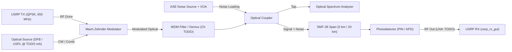

# Experiment README Template (`<experiment_id>`)

> Use this template for every experimental data collection campaign stored under `/export2/camontoya/sofa_datasets/<technology>/<source>/<experiment_id>/` and its companion lightweight folder in `GoogleDriveLAFI/resultados/<technology>/<source>/<experiment_id>/`.
> Structure grounded in experimental design best practices (clear hypothesis & baseline, explicit variable control, bias mitigation, statistical power & uncertainty reporting, and reproducible bench schematics).

---

## 1. Experiment Summary & Identification

- **Experiment ID:** `<experiment_id>`
- **Technology / Modulation:** `RoF QPSK` | `RoF 16-QAM`
- **Optical Source:** `DFB` | `USPL`
- **Capture Mode:** `usrp_rx_gui` | `usrp_rx_headless` | `usrp_rx_raw`
- **Measurement Dates:** `YYYY-MM-DD` to `YYYY-MM-DD`
- **Operators / Researchers:** `TODO: Names / GITA usernames`
- **GITA Path:** `/export2/camontoya/sofa_datasets/<technology>/<source>/<experiment_id>/`
- **Related Optical Spectra:** `TODO: link filenames under /export2/camontoya/sofa_datasets/espectros/`

---

## 2. Objective, Hypothesis & Baseline

- **Goal & Decision Driven:** `TODO: State the concrete physical or ML question this campaign answers and what decision depends on it.`
- **Testable Hypothesis:** `TODO: e.g., Removing the RF LNA on USPL WDM channel 24 maintains BER < 3.8e-3 (HD-FEC threshold) up to 20 km SMF for OSNR >= X dB.`
- **Reference Baseline / Control Condition:** `TODO: Specify the control group (e.g., 0 km Back-to-Back span or DFB baseline_650mhz) used for comparison.`

---

## 3. Experimental Design & Variables

### 3.1 Operationalized Variables

| Variable Role | Parameter | Levels / Values | Measurement Instrument |
| :--- | :--- | :--- | :--- |
| **Independent (IV)** | Fiber span (`distance_km`) | `0 km (B2B), 20 km` | Standard SMF-28 spools |
| **Independent (IV)** | OSNR / Noise loading step | `TODO: range and step (e.g., 0.5 dB)` | OSA + ASE source / VOA |
| **Dependent (DV — Primary)** | Bit Error Rate (`ber`) | Continuous `[0, 0.5]` | Offline DSP (`optnet_ml`) |
| **Dependent (DV — Primary)** | EVM RMS (`evm_rms_pct`, `evm_db`) | Continuous `%` / `dB` | Offline DSP (`optnet_ml`) |
| **Dependent (DV — Secondary)** | RF SNR (`snr_db`), Peak & Best-Window EVM | Continuous `dB` / `%` | USRP GNU Radio probe & DSP |
| **Controlled (Constant)** | Carrier frequency / Bit rate | `650 MHz / 1.88 Mbps` | NI USRP TX/RX |
| **Controlled (Constant)** | Optical launch power / Laser current | `TODO: e.g., 0 dBm, 370 mA` | Optical power meter / laser driver |
| **Controlled (Constant)** | RF amplification / MZM bias | `TODO: e.g., No LNA (NLNA), quadrature bias` | Bench power supply / bias tee |

### 3.2 Confounding Factors & Bias Mitigation

- **Potential Confounders:** `TODO: e.g., polarization drift, laser thermal drift, ambient table vibration, EDFA ASE power fluctuation, USRP USB drops.`
- **Standardization & Order Control:** `TODO: Describe stabilization warm-up time, sweep direction (ascending/descending OSNR), cooldown between captures (--cooldown 2.0), and whether conditions were repeated or interleaved.`

### 3.3 Instrumentation Validation (Pre-Flight Checks)

- **Pre-Capture Checks Performed:** `TODO: e.g., verified zero-error B2B constellation via pixi run check-signal, verified optical spectrum on OSA, confirmed optical power at PD below saturation.`
- **Calibration Notes:** `TODO: Record any proxy calibration (e.g., auxiliary ASE seed tone, optical tap ratio, fiber connector loss).`

### 3.4 Sample Size, Replication & Uncertainty Quantification

- **Replication Plan:** `TODO: e.g., N = 10 independent captures per (distance, OSNR) setpoint to estimate variance and detect transient bursts.`
- **Statistical Power & Resolution:** `TODO: State evaluated bits per capture and minimum resolvable BER floor (e.g., ~10^-5 per capture, ~10^-6 aggregated).`
- **Uncertainty Reporting:** Report mean alongside standard deviation / confidence intervals (e.g., `ber_vs_osnr_shaded.png`, `evm_vs_snr_shaded.png`) rather than single-point values.
- **Range of Applicability:** `TODO: State hardware/channel boundaries over which findings generalize.`

---

## 4. Physical Setup Schematic (Optical & RF Bench)

### Equipment Inventory & Settings

| Block | Equipment / Model | Key Settings |
| :--- | :--- | :--- |
| Optical Source | `TODO` | `TODO (wavelength / channel, bias current, temperature)` |
| Modulator | `TODO (Covega / Photline MZM)` | `TODO (V_bias, RF input power)` |
| Optical Amplifier / Noise | `TODO (Padtec EDFA / ASE)` | `TODO (gain / pump current / VOA attenuation)` |
| Optical Fiber | `TODO (SMF-28)` | `TODO (span lengths, measured insertion loss)` |
| Photodetector & RF Stage | `TODO` | `TODO (received optical power, LNA on/off)` |
| SDR TX / RX | `TODO (NI USRP-2904 / B210)` | `TODO (sample rate, SPS, TX/RX gain, PRBS order)` |

---

## 5. Dataset Inventory & Observed Telemetry

| Distance | Self-Contained NPZ Archive | Captures in NPZ | Raw `.complex64` | OSNR Range (dB) | Measured SNR Range (dB) |
| :--- | :--- | ---: | ---: | :--- | :--- |
| `0km` | `usrp_rx_gui_<slug>_0km.npz` | `0` | `0` | `TODO` | `TODO` |

- **Results CSV:** `results_<experiment_id>.csv`
- **Known Anomalies / Exclusions:** `TODO: Document any discarded captures, saturation regimes, or hardware resets.`
