# Experiment README Template (`<experiment_id>`)

> Standard per-campaign README template for datasets stored under `/export2/camontoya/sofa_datasets/<technology>/<source>/<experiment_id>/` and mirrored in `GoogleDriveLAFI/resultados/<technology>/<source>/<experiment_id>/`.
> Grounded in experimental design best practices (hypothesis & baseline, operationalized variable control, bias mitigation, statistical power & uncertainty reporting, and reproducible optical/RF bench schematics).

---

## 1. Experiment Summary & Identification

- **Experiment ID:** `<experiment_id>`
- **Technology / Modulation:** `RoF QPSK` | `RoF 16-QAM`
- **Optical Source:** `DFB` | `USPL + AAWG (Ch <N>) + EDFA`
- **Receiver RF Stage:** `PIN PD + LNA` | `PIN PD (No LNA / NLNA)`
- **Optical Noise Metric:** `OSNR` (DFB) | `OTNR — Optical Tone-to-Noise Ratio` (USPL)
- **Capture Mode:** `usrp_rx_gui` | `usrp_rx_headless` | `usrp_rx_raw`
- **Measurement Dates:** `YYYY-MM-DD` to `YYYY-MM-DD`
- **Operators / Researchers:** `TODO: Names / GITA usernames`
- **GITA Path:** `/export2/camontoya/sofa_datasets/<technology>/<source>/<experiment_id>/`
- **Related Optical Spectra:** `TODO: link filenames under /export2/camontoya/sofa_datasets/espectros/`

---

## 2. Objective, Hypothesis & Baseline

- **Goal & Decision Driven:** `TODO: State the concrete physical or ML question this campaign answers and what decision depends on it.`
- **Testable Hypothesis:** `TODO: e.g., Removing the receiver RF LNA on USPL WDM Ch 24 maintains BER below HD-FEC (3.8e-3) over 20 km SSMF for OTNR >= X dB.`
- **Reference Baseline / Control Condition:** `TODO: Specify the control reference (e.g., 0 km Back-to-Back span or dfb/baseline_650mhz).`

---

## 3. Experimental Design & Variables

### 3.1 Operationalized Variables

| Variable Role | Parameter | Levels / Values | Measurement Instrument |
| :--- | :--- | :--- | :--- |
| **Independent (IV)** | Fiber span (`distance_km`) | `0 km (B2B), 2 km, 20 km, 40 km` | Standard SSMF spools |
| **Independent (IV)** | Noise loading (`OSNR` for DFB / `OTNR` for USPL) | `TODO: range and step (e.g., 0.5 dB)` | OSA (10% tap) + Lightpad DFB + BOA + VOA |
| **Dependent (DV — Primary)** | Bit Error Rate (`ber`) | Continuous `[0, 0.5]` | Offline DSP (`optnet_ml`) |
| **Dependent (DV — Primary)** | EVM RMS (`evm_rms_pct`, `evm_db`) | Continuous `%` / `dB` | Offline DSP (`optnet_ml`) |
| **Dependent (DV — Secondary)** | RF SNR (`snr_db`), Peak & Best-Window EVM | Continuous `dB` / `%` | USRP GNU Radio probe & DSP |
| **Controlled (Constant)** | RF carrier / Bit rate / PRBS | `650 MHz / 1.88 Mbps / PRBS-17` | USRP TX/RX |
| **Controlled (Constant)** | Optical launch power / Laser bias | `TODO: e.g., 0 dBm, 370 mA` | Optical power meter / laser driver |
| **Controlled (Constant)** | Polarization / MZM bias / LNA state | `3-paddle PC (1-2-1 turns), quadrature bias, LNA on/off` | Manual PC, DC bias, RF bench |

### 3.2 Optical Noise Metric Definition (OSNR vs. OTNR)

- **DFB Source — OSNR:** Measured directly on the OSA (10% tap) as the contrast between the modulated DFB optical carrier peak and its adjacent ASE noise floor.
- **USPL Source — OTNR (Optical Tone-to-Noise Ratio):** Because spectrum slicing through the AAWG and double optical amplification raise the local noise floor around the sliced USPL channel, the Padtec Lightpad DFB laser in the noise-loading branch acts as an **auxiliary optical reference tone**. **OTNR** is measured on the OSA as the peak-to-floor contrast of this auxiliary tone against the adjacent visible ASE noise floor. *(In capture filenames, this value is stored in the `osnr...dB` field for parser compatibility.)*

### 3.3 Confounding Factors, Bias Control & Validation

- **Potential Confounders:** `TODO: Polarization drift, laser thermal drift, Padtec EDFA gain drift, ambient table vibration, USRP USB drops.`
- **Standardization & Sweep Order:** `TODO: Warm-up duration, ascending/descending VOA attenuation sweep order, --cooldown interval.`
- **Pre-Flight Validation:** `TODO: B2B constellation check (pixi run check-signal), OSA spectrum check, optical power at PIN PD verified below saturation.`
- **Replication & Uncertainty:** `TODO: Repetitions per setpoint (N), evaluated bits per capture, min resolvable BER floor, and shaded mean ± std / CI plots.`
- **Range of Applicability:** `TODO: Channel, fiber span, and hardware boundaries over which findings generalize.`

---

## 4. Physical Setup Schematic (Optical & RF Bench)

### Variant A: USPL + AAWG + EDFA Source (with optional LNA)

```mermaid
flowchart LR
    subgraph SRC["Optical Source (USPL)"]
        USPL["USPL Laser (TODO mA)"] --> AAWG["AAWG (Ch TODO)"]
        AAWG --> EDFA1["EDFA 1 (Padtec S/N: TODO)"]
    end

    subgraph TX_STAGE["RoF Transmitter"]
        PC["3-Paddle PC (1-2-1 turns)"] -->|"Opt IN"| MZM["MZM (Model: TODO)"]
        USRP_TX["USRP TX (S/N: TODO, QPSK 650 MHz)"] --> RFDRV["RF Driver (Model: TODO)"]
        RFDRV -->|"RF Port"| MZM
        MZM --> EDFA2["EDFA 2 Booster (Padtec S/N: TODO)"]
    end

    subgraph NOISE["Noise Loading Branch"]
        LP_DFB["Padtec Lightpad DFB (Aux Tone)"] --> BOA["EDFA 3 / BOA (Padtec S/N: TODO)"]
        BOA --> VOA["VOA"]
    end

    subgraph MON["OTNR Monitoring"]
        CPL12["1x2 Balanced Combiner"] --> CPL9010["90/10 Unbalanced Splitter"]
        CPL9010 -->|"10% Tap"| OSA["OSA (OTNR Monitor)"]
    end

    subgraph LINK["Fiber Link"]
        SSMF["SSMF Span (0, 2, 20, 40 km)"]
    end

    subgraph RX_STAGE["Direct-Detection Receiver"]
        OC["Optical Circulator"] --> PD["PIN Photodiode (Model: TODO)"]
        PD --> LNA["RF LNA (Omit if NLNA)"]
        LNA --> USRP_RX["USRP RX (S/N: TODO, usrp_rx_gui)"]
    end

    subgraph DSP["Offline DSP"]
        OPTNET["optnet_ml (Demod, BER & EVM)"]
    end

    EDFA1 --> PC
    EDFA2 --> CPL12
    VOA --> CPL12
    CPL9010 -->|"90% Signal + Noise"| SSMF
    SSMF --> OC
    USRP_RX -.->|".complex64 / .npz"| OPTNET
```

*(For **DFB** campaigns, replace the `Optical Source (USPL)` subgraph with a single `DFB Laser (S/N: TODO)` node feeding `PC` directly, and monitor **OSNR** on the OSA. For **NLNA** campaigns, remove the `RF LNA` block so `PIN Photodiode` connects directly to `USRP RX`.)*

### Equipment Inventory & Settings

| Subsystem | Component | Model / Serial Number | Set & Measured Parameters |
| :--- | :--- | :--- | :--- |
| Optical Source | DFB or USPL | `TODO (S/N)` | `TODO (bias current, temperature, wavelength)` |
| Spectrum Slicer *(USPL only)* | AAWG | `TODO` | `TODO (ITU channel / center wavelength)` |
| Source Amp *(USPL only)* | EDFA 1 (Padtec) | `TODO (S/N)` | `Set gain: TODO dB · Measured (Padtec SW): TODO dB` |
| Polarization Control | 3-Paddle PC | Manual 3-paddle (`1-2-1` turns) | Tuned for max MZM optical throughput |
| RF Transmitter | USRP TX + RF Driver | `USRP S/N: TODO · Driver: TODO` | `650 MHz, QPSK, 1.88 Mbps, PRBS-17, TX gain: TODO` |
| Optical Modulator | MZM | `TODO (Covega / Photline model)` | `V_bias: TODO V · RF drive: TODO dBm` |
| Booster Amp | EDFA 2 (Padtec) | `TODO (S/N)` | `Set gain: TODO dB · Measured (Padtec SW): TODO dB` |
| Noise Source | Lightpad DFB + EDFA 3 (BOA) + VOA | `BOA S/N: TODO · VOA: TODO` | `Set gain: TODO dB · Measured: TODO dB · VOA sweep: TODO` |
| Coupling & Monitoring | 1:2 Balanced + 90/10 Tap + OSA | `OSA: TODO` | `10% tap -> OSA (OSNR / OTNR) · 90% -> Fiber` |
| Fiber Link | SSMF Spools | `SMF-28` | `0 km (B2B), 2 km, 20 km, 40 km · Loss: TODO dB` |
| Receiver | Optical Circulator + PIN PD + LNA + USRP RX | `PD: TODO · LNA: TODO/Omitted · USRP RX S/N: TODO` | `Rx opt power: TODO dBm · RX gain: TODO` |

---

## 5. Dataset Inventory & Observed Telemetry

| Distance | Self-Contained NPZ Archive | Captures in NPZ | Raw `.complex64` | OSNR / OTNR Range (dB) | Measured SNR Range (dB) |
| :--- | :--- | ---: | ---: | :--- | :--- |
| `0km` | `usrp_rx_gui_<slug>_0km.npz` | `0` | `0` | `TODO` | `TODO` |

- **Results CSV:** `results_<experiment_id>.csv`
- **Known Anomalies / Exclusions:** `TODO: Document discarded captures, saturation regimes, or hardware resets.`
