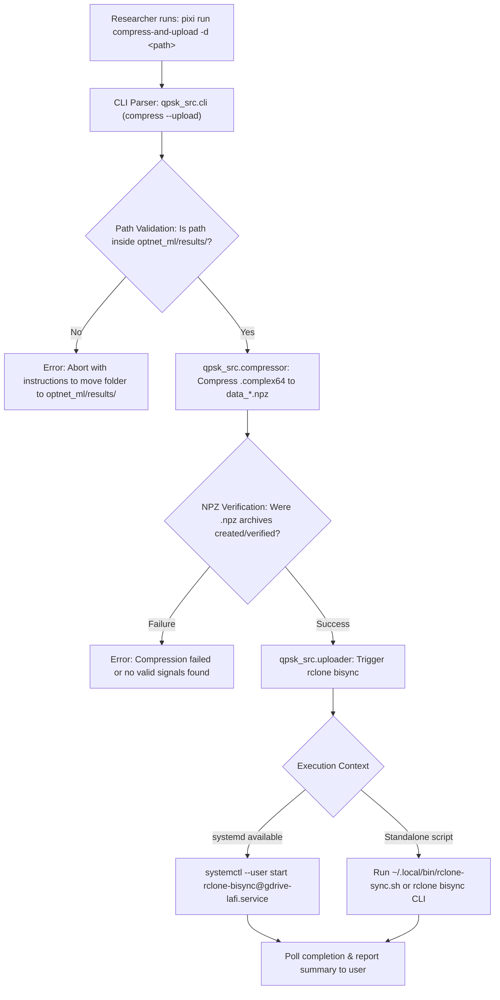

# Design Document: Dataset Compression & Google Drive Sync Pipeline

**Date:** 2026-09-26  
**Status:** Approved  
**Target:** `optnet_ml` QPSK Signal Processing Pipeline  
**Audience:** Lab Researchers (Hanna & David) and Developers

---

## 1. Executive Summary

When capturing experimental optical signals in the laboratory, large numbers of uncompressed raw `.complex64` files are generated across distance directories (e.g., `0km`, `20km`). To prevent filling up the Google Drive storage quota (which has a strict limit of 15 GiB), raw `.complex64` files are strictly excluded from automated cloud synchronization. Instead, all captures within an experiment must be compressed into compact `.npz` archives prior to upload.

This design introduces a unified, developer- and researcher-friendly workflow:
```bash
pixi run compress-and-upload -d <dataset_dir>
```
This single command automates the entire post-capture routine:
1. Validates that the experiment folder resides strictly inside the Google Drive tree (`optnet_ml/results/...`).
2. Compresses all raw `.complex64` files into `.npz` archives for every distance subfolder.
3. Triggers immediate, conflict-free bidirectional synchronization with Google Drive via the existing `rclone-bisync` system infrastructure.
4. Outputs human-readable summaries of space saved and sync status.

---

## 2. Requirements & Constraints

### 2.1 Functional Requirements
- **FR-1:** Compress all `.complex64` files within distance folders of the specified dataset directory into `data_<folder_name>.npz`.
- **FR-2:** Support single distance folders (e.g. `optnet_ml/results/.../0km`) as well as full experiment directories containing multiple distance folders (`0km`, `2km`, `20km`, etc.).
- **FR-3:** Enforce that target datasets reside inside the repository/Google Drive results hierarchy (`optnet_ml/results/...`). If an external directory is passed (e.g. `~/Muestras_Laboratorio/` or `~/Descargas/`), reject execution with a clear, actionable error message instructing the user to move the folder into `optnet_ml/results/`.
- **FR-4:** Trigger immediate cloud synchronization via `rclone bisync` without relying on separate manual `rclone copy` commands, preserving bisync baseline cache integrity and avoiding modtime collision warnings.
- **FR-5:** Expose the workflow as an intuitive task in `pixi.toml` (`compress-and-upload`) and as a `--upload` flag on the `compress` CLI command.
- **FR-6:** Provide a `--dry-run` option to simulate compression and sync without performing destructive actions or network transfers.

### 2.2 Non-Functional Constraints
- **C-1 Zero Guru Overhead:** Researchers must not be required to know Linux systemd syntax, rclone commands, or filter syntax. One command with the folder path must suffice.
- **C-2 Absolute Exclusion of Complex64:** Under no circumstances should `.complex64` files be uploaded to Google Drive.
- **C-3 Platform Consistency:** Must run seamlessly on the reception PC (`lab18305pc2`), local workstations, and server nodes where `pixi` is installed.

---

## 3. Architecture & Data Flow



### 3.1 Rclone Bisync Integration (Why Not Direct `rclone copy`)
Directly running `rclone copy` on new `.npz` files outside of `rclone bisync` introduces files onto Google Drive that do not exist in bisync's cached listing (`.lst`). During the subsequent periodic sync, bisync reports:
```text
NOTICE: - WARNING  New or changed in both paths - data_0km.npz
```
Furthermore, differences in timestamp truncation between cloud and filesystem can trigger false conflict resolutions. By triggering `rclone bisync` directly:
- Bisync detects the `.npz` files as newly created on local disk.
- It uploads them to `lafi:` using the configured rate limits (`--bwlimit 10M` or `2M`) and exclusions (`- *.complex64`).
- It atomically updates the local cache `.lst` file.
- Total consistency is guaranteed across all nodes (local, GITA, reception PC).

---

## 4. Component Details

### 4.1 `optnet_ml/qpsk_src/uploader.py`
A new module dedicated to path validation and cloud synchronization triggering:
- `validate_results_path(dataset_path: Path | str) -> Path`:
  - Resolves path to absolute.
  - Verifies existence and directory type.
  - Checks if `optnet_ml/results` is part of the resolved path.
  - Raises `ValueError` with user-facing guidance if external.
- `trigger_gdrive_sync(timeout_seconds: int = 300, dry_run: bool = False) -> Tuple[bool, str]`:
  - If `dry_run=True`, prints planned sync action and returns success.
  - Checks if systemd user manager has `rclone-bisync@gdrive-lafi.service` or `rclone-bisync.service`.
  - If available, invokes `systemctl --user start --wait <unit>`.
  - Fallback: Checks for `~/.local/bin/rclone-sync.sh` or invokes `rclone bisync` directly with environment filter definitions.
  - Returns `(success: bool, message: str)`.

### 4.2 `optnet_ml/qpsk_src/cli.py`
Extend the existing `compress` subparser:
```python
compress_parser.add_argument(
    "--upload",
    action="store_true",
    help="Trigger immediate Google Drive synchronization after compression.",
)
compress_parser.add_argument(
    "--dry-run",
    action="store_true",
    help="Simulate compression and upload without writing or syncing files.",
)
```
When `--upload` is specified:
1. Calls `validate_results_path(args.dataset_dir)`.
2. Executes compression of all detected distance folders.
3. Collects statistics: number of `.complex64` processed, number of `.npz` created, space reduced.
4. Calls `trigger_gdrive_sync(dry_run=args.dry_run)`.
5. Prints a friendly confirmation banner.

### 4.3 `optnet_ml/pixi.toml`
Add the convenient task:
```toml
[tasks]
compress-dataset = "python3 -m qpsk_src.cli compress"
compress-and-upload = "python3 -m qpsk_src.cli compress --upload"
```

### 4.4 Documentation (`optnet_ml/README.md`)
Add a dedicated guide section for researchers:
- **Title:** "Flujo de Captura y Subida de Datos (Hanna & David)"
- **Location requirement:** Where to place new measurement folders (`optnet_ml/results/hanna_maestria/<nombre_experimento>/`).
- **Command:** `pixi run compress-and-upload -d results/hanna_maestria/<nombre_experimento>`
- **Expected output:** Explanation of what happens (compression -> verification -> bisync).

---

## 5. Verification & Testing Plan

### 5.1 Automated Unit Tests (`optnet_ml/tests/test_uploader.py`)
- `test_validate_results_path_valid`: Passes with paths inside `optnet_ml/results/...`.
- `test_validate_results_path_external`: Raises `ValueError` when given `/tmp/data` or `~/Downloads/`.
- `test_trigger_gdrive_sync_dry_run`: Returns `True` without executing system commands.
- `test_trigger_gdrive_sync_systemd_success`: Mocks `subprocess.run` on `systemctl --user start` and verifies correct invocation.
- `test_cli_compress_with_upload_flag`: Tests end-to-end CLI execution with mocked sync.

### 5.2 Manual Verification
- Run `pixi run compress-and-upload -d results/hanna_maestria/... --dry-run` and inspect terminal output.
- Run `pixi run test` to verify zero regressions across existing suite.
